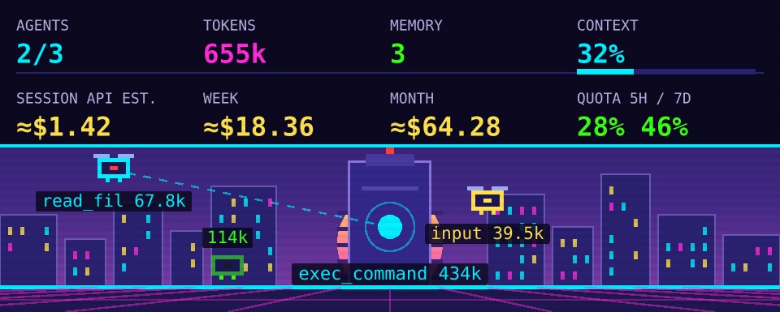
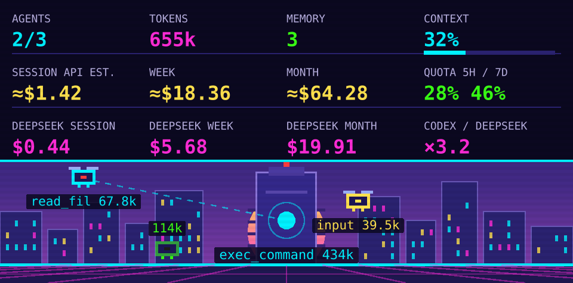

# Codex Consumption (VS Code)

An animated cyberpunk dashboard for Codex, adapted from [Claude Consumption](https://github.com/aelmizeb/claude-consumption-vscode). The main session is a tower with a beating heart; sub-agents are drones that fly while working and land when finished. The HUD shows tokens, context, estimated API costs, persistent memory and subscription quotas.



The extension reads local Codex rollout files. It makes no network requests, requires no API key, and does not modify Codex configuration or read authentication files.

## Install

Build the extension, then install the VSIX:

```sh
npm ci
npm run package
code --install-extension codex-consumption-vscode-0.1.1.vsix
```

Building requires Node.js 22 or newer. You can also use **Extensions → … → Install from VSIX…** in VS Code. Run **Codex Consumption: Open Panel** from the command palette to open the view.

By default the panel sits below the Codex chat in the secondary side bar, using the installed OpenAI extension's `codexSecondaryViewContainer`. If that extension is absent, the dashboard uses its own **Codex Consumption** container. Set `codexConsumption.dock` to `own` to use the independent container. You can also drag the view to another bar or panel.

## What it shows

- **Agents and tools:** the main conversation and its child threads, including nested agents. Drones show the current tool, status and token total; hover for the agent's role and description. Completion and interruption events determine when they land. Inactivity changes a running agent to idle.
- **Tokens:** uncached input, cached input, cache writes and output, summed across the session family. Cached input is part of Codex's reported input total, and reasoning is part of output; neither is counted twice. Repeated cumulative usage records are deduplicated.
- **Context:** the latest model request's total tokens divided by Codex's reported model context window. Set `contextWindow` to override the denominator. Missing context information shows `--`.
- **API estimates:** the session, current calendar week (Monday onward), and current month. Period totals include all local sessions and archives, regardless of the panel's workspace filter. Usage is attributed to the timestamp of each usage event. The live session family replaces its cached totals, so it is included once.
- **Memory:** entries in `<CODEX_HOME>/memories/MEMORY.md`, falling back to `memory_summary.md`. Counts linked index entries and level-two headings. Zero means no recognized memory entries were found.
- **Quota:** the subscription windows recorded by Codex in `token_count.rate_limits`, including their actual durations (usually 5h / 7d). Samples older than fifteen minutes or past a window's reset show `--`. This is the last locally recorded sample; it refreshes when Codex writes another event. No status-line bridge is needed.
- **Optional DeepSeek comparison:** equivalent token costs at DeepSeek V4 Pro peak rates, with week/month totals and the Codex / DeepSeek ratio. Enable `compareWithDeepSeek`; adjust `comparisonPrice` to compare other rates.



## Data and accuracy

Codex writes `sessions/YYYY/MM/DD/rollout-*.jsonl` under its home directory, and may move older threads into `archived_sessions`. The home defaults to `CODEX_HOME`, then `~/.codex`; `codexConsumption.configDir` overrides it. Metadata provides the working directory and parent thread relationships. The workspace filter matches the open folders and their descendants using directory boundaries.

The reader handles `session_meta`, `turn_context`, `response_item`, `event_msg.token_count` and newer `token_usage_record` records. Active transcripts are read incrementally every two seconds. Historical period totals are scanned at startup, when switching sessions, every five minutes, and with **Rescan Week and Month Costs**. The cache contains numeric totals, not conversation text. Local transcript schemas are internal Codex formats and may change; unsupported events are ignored. Child threads need a parent relationship or a recognized spawn result to be attached to the main session.

Every cost is an **estimated token equivalent at standard, short-context API rates**, marked `≈`. These figures are not ChatGPT subscription bills or authoritative account spend. They exclude long-context multipliers, Fast/Flex/Batch discounts or premiums, regional adjustments, tool fees and other charges. Rates are a snapshot checked on October 31, 2026; historical usage is valued using this snapshot. Unknown models or providers contribute to token totals. Dollar totals sum only recognized models; the dashboard displays the estimated amount without an unpriced-record counter. The optional comparison uses the same recorded token counts; tokenization can differ between providers.

Built-in rates cover GPT-6 Astra, GPT-6.1 Sol, GPT-6.1 Terra, GPT-6 Luna, GPT-5.6 Sol, GPT-5.5 and GPT-5.3 Codex. Configure `customPrices` for other models, or to override a built-in price:

```json
{
  "codexConsumption.customPrices": {
    "your-model-id": { "input": 2, "output": 10, "cacheRead": 0.1, "cacheWrite": 2.5 }
  }
}
```

All rates are USD per million tokens. If a cache-write rate is omitted, it defaults to 1.25× input. Non-OpenAI providers use `<provider>/<model>` as their price key.

Sources: [OpenAI API pricing](https://developers.openai.com/api/docs/pricing), [GPT-5.6 Sol](https://developers.openai.com/api/docs/models/gpt-5.6-sol), [GPT-5.5](https://developers.openai.com/api/docs/models/gpt-5.5), and [DeepSeek pricing](https://api-docs.deepseek.com/quick_start/pricing/). The [official Codex App Server documentation](https://learn.chatgpt.com/docs/app-server) describes the meaning of quota percentages and reset timestamps. This extension reads their locally recorded equivalents and does not start an app server.

## Settings and commands

| Setting (`codexConsumption.`) | Default | Purpose |
| --- | --- | --- |
| `dock` | `codex` | Below Codex chat, or `own` container |
| `scope` | `workspace` | Open folders, or `all` local sessions |
| `configDir` | empty | Override Codex home |
| `pollSeconds` | `2` | Active transcript refresh interval |
| `idleAfterSeconds` | `600` | Inactivity threshold |
| `contextWindow` | `0` | Use Codex's reported window, or a token override |
| `compareWithDeepSeek` | `false` | Show the optional comparison row |
| `customPrices` | `{}` | Per-model price overrides |
| `comparisonPrice` | input `1.32`, output `3.96`, cached `0.044` | DeepSeek V4 Pro peak rates |

Commands: **Open Panel**, **Refresh**, **Rescan Week and Month Costs**, and **Show Log**, all under **Codex Consumption**.

If no session appears, start a Codex conversation in an open workspace folder, check `configDir`, or change `scope` to `all`. **Show Log** reports which session is followed and any read failures. In a remote VS Code window, the extension reads files on the extension host; configure Codex home there.

## Development

```sh
npm ci
npm test
npm run watch
npm run package
```

Press **F5** to launch an Extension Development Host. Tests cover transcript usage, cumulative record deduplication, workspace matching, nested and archived agents, file truncation, partial UTF-8 writes, period accounting, custom pricing, quota freshness and SVG escaping. CI builds and tests on Node.js 22, packages the VSIX, and attaches it to releases tagged `v*`.

MIT license. Adapted from Claude Consumption by Abdellatif El Mizeb.
